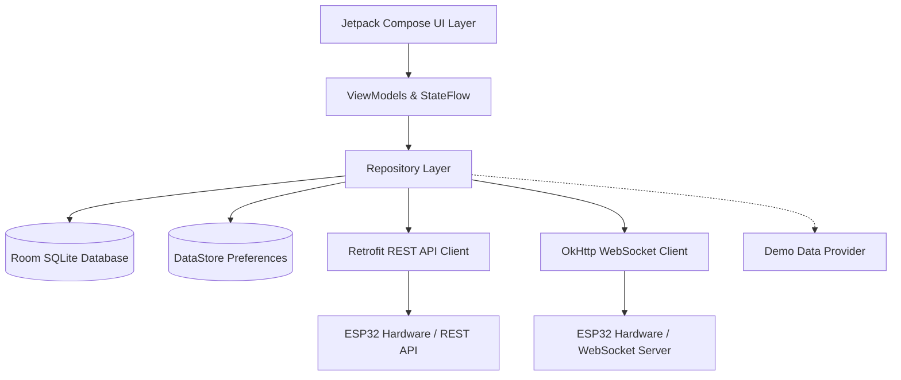

# NetShield IoT — Android Network Security Dashboard

> **Network Visibility. Smarter Protection.**

[](https://kotlinlang.org)
[](https://developer.android.com/jetpack/compose)
[](https://m3.material.io)
[](https://developer.android.com/training/data-storage/room)
[](https://square.github.io/okhttp)

NetShield IoT is an enterprise-grade Android administrative dashboard for an **ESP32-based embedded DNS Filtering Engine / Sinkhole**. It monitors local network DNS traffic in real time, manages domain blocklists, analyzes observed client devices, and provides hardware telemetry for the ESP32 security gateway.

Designed with a professional **cybersecurity / network operations center (NOC)** aesthetic, restrained colors, strong visual hierarchy, accessible contrast, and zero AI-dashboard clutter.

---

## Architecture Overview

NetShield IoT is built following Google's modern Android architecture guidelines (**Clean Architecture + MVVM + Repository Pattern**):



### Module Breakdown:
- **Presentation Layer**: 100% Jetpack Compose with Material 3, Navigation Compose, custom Canvas charts, and state-hoisted ViewModels.
- **Domain Layer**: Immutable business models (`DnsEvent`, `BlockedDomain`, `Device`, `SystemStatus`, `DashboardStats`) and repository contracts.
- **Data Layer**:
  - **Room Database**: Offline caching of DNS queries, blocked domains, and observed client devices.
  - **DataStore**: Asynchronous persistence of IP configuration, language, and theme preferences.
  - **Retrofit & OkHttp**: Type-safe REST client for hardware stats, health check, and blocklist synchronization.
  - **OkHttp WebSocket**: Real-time event streaming with automatic exponential backoff reconnection.
  - **Demo Mode Provider**: Realistic simulated data stream for live demonstrations without hardware.

---

## Key Features & Screen Destinations

### 1. Dashboard
- **System Status Card**: Real-time ESP32 online/offline indicator, IP address, DNS engine state, uptime, and last sync timestamp.
- **Statistics Grid**: Responsive cards for **Total Requests**, **Blocked Requests** (with percentage), **Allowed Requests**, and **Unique Devices**.
- **Traffic Analytics**: Custom Canvas line chart depicting 24-hour DNS request volume with total vs. blocked query curves.
- **Recent DNS Activity**: Chronological list of intercepted queries with domain, client IP, ALLOW/BLOCK status pill, and category tag.
- **Threat Intelligence Summary**: Displays active threat feeds, total rules loaded, engine version, and heuristic filtering notes.

### 2. Live Traffic
- **Real-Time Streaming**: Real-time feed powered by OkHttp WebSocket (or simulated generator in Demo Mode).
- **Default Noise Suppression**: Defaults to displaying blocked threat domains only, reducing background telemetry noise with one-tap toggle to reveal all traffic.
- **Search & Query Inspection**: Real-time filter by domain name or client IP address.
- **Interactive Query Detail Modal**: Tap any event row to inspect full query parameters, timestamp in Western Indonesia Time (WIB), engine source, and quick domain copying.
- **Action Filters**: Instant toggling between **Blocked**, **All**, and **Allowed** queries.
- **Category Filter Chips**: Fast horizontal filtering across *Malware*, *Phishing*, *Gambling*, *Adult*, *Ads & Trackers*, *Development*, etc.
- **Instant Security Alerts**: High-priority heads-up notifications with audible sound and vibration alerts when malicious or sensitive domains are intercepted.
- **Stream Controls**: Pause/Resume stream button and clear log action.

### 3. Blocklist Management
- **Domain Directory**: Comprehensive management interface displaying all sinkholed domains, categories, and creation dates.
- **Add Domain Modal**: Domain validation using RFC compliant regex (`^[a-zA-Z0-9][-a-zA-Z0-9]*(\.[a-zA-Z0-9][-a-zA-Z0-9]*)+$`) with category dropdown.
- **Delete Confirmation**: Guarded removal dialog to prevent accidental rule deletion.
- **Hardware Synchronization**: One-click sync button pushing updated rules directly into the ESP32 engine.

### 4. Devices & Client Activity Drill-Down
- **Observed Client List**: Identifies all network hosts generating DNS queries with their assigned IP and hardware MAC address.
- **Interactive Device History Bottom Sheet**: Tap any device card to inspect comprehensive metrics and the complete chronological list of domains accessed by that specific host.
- **Traffic Metrics**: Displays query count, blocked query count, and block ratio percentage per device.
- **Sorting Options**: Sort devices by *Most Requests*, *Most Blocked*, *Recent Activity*, or *IP Address*.
- **Standardized WIB Timestamps**: Accurate local timestamps formatted in Western Indonesia Time (WIB, UTC+7).

### 5. Settings
- **Dual Operating Modes**:
  - **Demo Mode**: Uses realistic local sample data for presentations and classroom demos without physical hardware.
  - **Live Mode**: Binds directly to the physical ESP32 REST and WebSocket endpoints over the local network.
- **ESP32 Connection Configuration**: Configurable IP address, REST API port, and WebSocket port.
- **Connection Test**: Heartbeat test with feedback indicator.
- **Theme Selection**: Full Material 3 support for **Follow System**, **Light Theme** (neutral off-white), and **Dark Theme** (deep slate charcoal).
- **Multi-Language**: Instant runtime switching between **English (en)** and **Bahasa Indonesia (id)** with persistence.
- **Local Persistence & Cache Management**: One-click cache cleanup for local Room databases.

---

## ESP32 Firmware Implementation

The hardware layer runs on an ESP32-C3 microcontroller located at `firmware/esp32_c3_netshield/esp32_c3_netshield.ino`. Key capabilities include:
- **Upstream DNS Filtering**: Uses Cloudflare for Families (`1.1.1.3`) for upstream DNS resolution, which automatically blocks malware, phishing, and adult content at the resolver level.
- **Aggressive Telemetry Filtering**: Drops internal background telemetry and DoH probes (Apple, Google, Microsoft OS services) from the live log to focus on user website queries.
- **Non-Blocking Network Architecture**: Runs WebSocket and REST loops concurrently inside UDP DNS wait loops to prevent client timeouts.
- **Local Rule Cache**: In-memory hash and prefix matching for instant zero-latency domain interception.

## ESP32 Firmware API Specification

The Android application communicates with the ESP32 through standard REST and WebSocket endpoints. For complete JSON schemas, error codes, and Arduino C++ code snippets, see [docs/ESP32_API_CONTRACT.md](docs/ESP32_API_CONTRACT.md).

| Method | Endpoint | Description |
| :--- | :--- | :--- |
| `GET` | `/api/v1/health` | Connectivity heartbeat check |
| `GET` | `/api/v1/status` | Hardware health, uptime, and engine state |
| `GET` | `/api/v1/stats` | Cumulative request counters |
| `GET` | `/api/v1/traffic` | Hourly 24-hour traffic series for chart |
| `GET` | `/api/v1/traffic/recent` | Recent buffered DNS queries |
| `GET` | `/api/v1/blocklist` | List of blocked domains |
| `POST` | `/api/v1/blocklist` | Add domain to blocklist |
| `DELETE`| `/api/v1/blocklist/{id}` | Remove domain from blocklist |
| `POST` | `/api/v1/blocklist/sync` | Trigger ESP32 blocklist reload |
| `GET` | `/api/v1/devices` | Observed client devices |
| `WS` | `ws://<ip>:81/ws` | Real-time DNS query streaming |

---

## Multi-Language Support (Localization)

All user-facing strings are localized without hardcoded values:
- **English**: `app/src/main/res/values/strings.xml`
- **Indonesian**: `app/src/main/res/values-in/strings.xml`

Language selection is preserved across app restarts via DataStore preferences.

---

## Building and Running the Project

### Prerequisites:
- Android Studio Ladybug / Meerkat or newer
- JDK 17 / 21 / 25
- Android SDK 35+ (targetSdk 37, minSdk 24)

### Command-Line Build:
```bash
# Verify and assemble debug APK
./gradlew assembleDebug

# Run unit tests
./gradlew testDebugUnitTest
```

The resulting APK will be located at:
`app/build/outputs/apk/debug/app-debug.apk`

---

## Security Notice

REST and WebSocket communications with the ESP32 operate over cleartext HTTP and WebSocket protocols intended for private local home networks (LAN) or isolated IoT testbeds. For external network access, consider routing traffic through a local WireGuard/Tailscale VPN tunnel.

---

## License

NetShield IoT is developed under the Apache 2.0 License.
